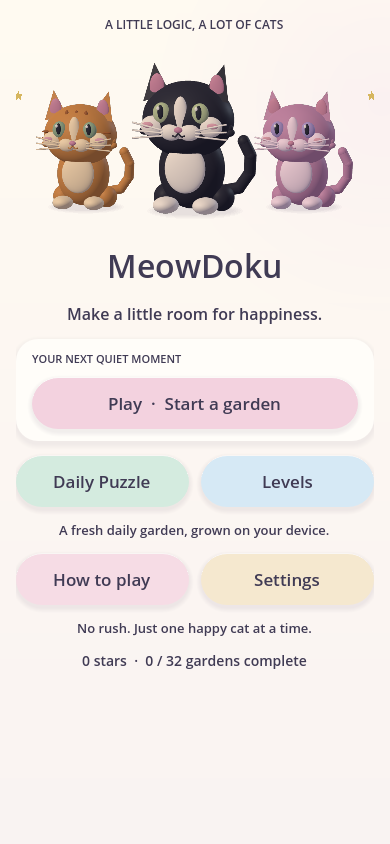
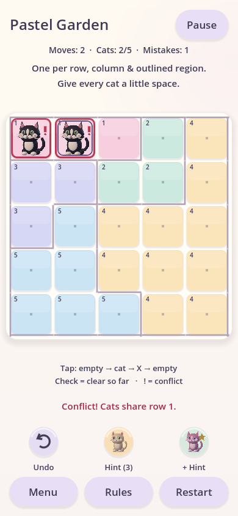
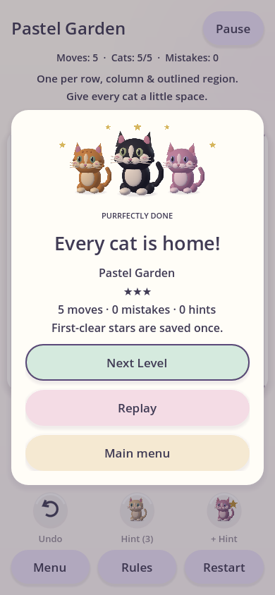

# Mobile UI and art direction

The existing puzzle engine and production levels remain in use. Task 3 adds an
original cream-and-pastel cat garden design using procedural illustration and an
editable Godot Theme. No downloaded images, paid assets, or external fonts are
required.

## Screens and navigation

- **Main menu:** Play, Daily Puzzle, Levels, How to Play, and Settings. Content
  scrolls on short phones so controls never have to shrink below touch size.
- **Level selection:** 32 validated puzzles across Easy, Medium, Hard and Expert,
  with saved boards, locks/unlocks and completion stars.
- **Daily Puzzle:** a five-by-five puzzle selected from the curated campaign using
  the device's local date, catalog seed and puzzle seed. It is offline and stable
  for that date and
  generator version, and has no server, streak, notification, or account.
- **Puzzle:** selected-cell ring, procedural cat faces, X notes, numbered region
  outlines, check/exclamation feedback, move count, Pause, Rules, Restart, Menu.
- **Tutorial:** three short illustrated rule cards and interactive practice cells
  that demonstrate the full empty → cat → X → empty cycle.
- **Pause:** modal card with Resume, Rules, Settings, Restart, and Main Menu.
  The board and moves remain intact beneath it. Input is suspended while open.
- **Victory:** celebratory cat expression, puzzle name and moves, level selection,
  replay, and menu. It opens only after the engine confirms every rule passes.
- **Settings:** reduced motion, optional haptics and difficulty-based mistake
  limits, saved in the versioned local save repository, plus Privacy & optional ads.
- **Optional hints:** a separate choices screen and debug-only local ad simulator;
  real advertising remains disabled. See [monetization.md](monetization.md).

In-game Rules/Settings return to pause without losing the board. Escape/Android
Back opens or dismisses pause; application backgrounding also pauses gameplay.
Returning to the main menu preserves the board. Resume restores it after closing
the app as well. See [progression.md](progression.md) for saving, undo, hints,
confirmed restart and one-time rewards added in Task 4.

## Shared components and assets

| File | Role |
| --- | --- |
| `resources/purr_theme.tres` | Editable cream panels, rounded lavender buttons, subtle shadows, high-contrast ink and focus outlines |
| `scripts/ui_theme.gd` | Shared region palette and theme loading |
| `scripts/ui_components.gd` | Cards, buttons, wrapped labels, scroll layouts, portraits, fades and modal focus loops |
| `scenes/components/cat_portrait.tscn`, `scripts/cat_portrait.gd` | Original procedural cat with happy, sleepy and celebrating expressions |
| `scripts/grid_cell.gd` | Reusable drawn cell with selection, original cat, X, check, ! and region ID/edges |
| `scripts/mobile_safe_area.gd` | Physical mobile safe-area to logical canvas conversion, with test inset overrides |
| `scripts/player_preferences.gd` | Saved comfort settings and optional supported-device haptic requests |
| `scripts/info_page.gd` | Shared tutorial, settings and level-selection page composition |
| `scripts/modal_page.gd` | Reusable pause/victory modal with content-sized, scrollable card |
| `assets/app_icon.svg` | Original vector cat project icon |

The existing five pastel region colors are retained: pink, mint, lavender,
cream-yellow and sky blue. Text uses dark plum ink. A selected cell has an inset
ring, a legal cat has a check, and an invalid cat has an exclamation mark and a
specific explanation. Numbered outlines identify regions without depending only
on color. Keyboard focus is visibly outlined, and modal focus loops keep Tab
navigation inside the card.

## Layout and comfort

Anchors, margin/VBox/HBox/grid/aspect containers and scroll areas handle sizing.
Menu/action buttons are at least 48 logical units high (usually 52–56). The
production five-by-five boards retain at least 48×48 logical-unit cells at all
tested sizes. Compact spacing and slightly smaller secondary text engage below
700 logical units of available height. Rules/settings/level pages scroll rather
than clipping content; scroll areas follow keyboard focus.

On Android/iOS, MobileSafeArea reads the display safe rectangle and converts its
physical insets into logical canvas margins. Both pages and modal cards use it.
Desktop tests simulate notch and home-indicator insets. Portrait orientation and
touch-to-mouse events are configured in the project.

Normal motion consists of a 0.18-second screen/card fade and a 0.20-second cat pop.
Reduced Motion skips both. Haptics are off by default and issue short requests
only on Android/iOS. Device support and Android export vibration permission must
be verified during mobile packaging; desktop tests do not validate vibration.

## Verification

Run from the project directory using the portable engine described in README:

```powershell
& $engine --headless --editor --path . --import --quit
& $engine --headless --path . --script res://tests/engine_tests.gd
& $engine --headless --path . --script res://tests/test_runner.gd
& $engine --headless --path . --script res://tests/mobile_ui_tests.gd
node tests/validate_project.js
```

For rendered UI checks and refreshed screenshots:

```powershell
& $engine --path . --script res://tests/mobile_ui_tests.gd -- --capture
```

The UI suite exercises menu/puzzle/pause/victory flow, actual pointer-event
navigation, modal keyboard focus, local preferences, daily reproducibility,
tutorial practice, replay, input suspension, and Reduced Motion. It tests
320×568, 320×640, 390×844, 430×932, and 768×1024 canvases, plus simulated 44-unit
top and 34-unit bottom safe insets. Settings tests use a separate temporary
preferences file, preserving player settings.

Initial checks caught and fixed the shortest-phone layout overflow, a practice
cell test lookup, and deferred focus requests after a screen had been removed.
Final results are recorded in README. These are Windows/Godot tests, not physical
Android or iPhone testing. Mobile export/signing remains outside this task.

## Screenshots

Rendered captures are in `artifacts/mobile/`:

- `01-main-menu.png`, `02-settings.png`, `03-tutorial.png`
- `04-level-selection.png`, `05-daily-puzzle.png`, `06-puzzle-conflict.png`
- `07-pause.png`, `08-victory.png`, `09-safe-area.png`
- `size-*.png` plus `small-main-menu.png`, `small-pause.png`, `small-victory.png`





## Asset status

There are no borrowed or temporary character images: all cats, board symbols,
portraits and the project icon are original procedural/vector artwork. The UI
uses Godot's bundled default font rather than a custom typeface. No sound/music
assets, animated splash sequence, or platform-specific store icon variants are
supplied. The project boots against the cream background without a stock splash
image. Those omissions do not block the verified playable UI.
